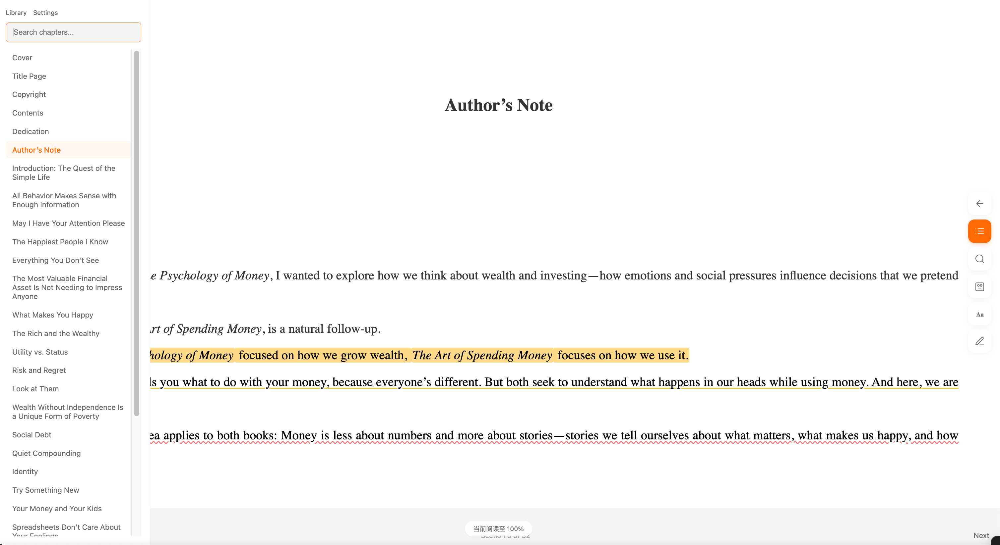

# reader 3 Pro



A lightweight, self-hosted EPUB reader that lets you read through EPUB books one chapter at a time. This makes it very easy to copy paste the contents of a chapter to an LLM, to read along. Basically - get epub books (e.g. [Project Gutenberg](https://www.gutenberg.org/) has many), open them up in this reader, copy paste text around to your favorite LLM, and read together and along.

This project is an enhanced version (thus add `pro` to repo name) of Andrie Karpathy's reader3 project.


## How It Works

#### Reader

1. `src/reader3_app/reader3.py` parses an `.epub`, cleans HTML, extracts plain text, and writes a `books/{bookname}_data/` folder.
2. The folder contains `book.pkl` (a pickled `Book` dataclass) and `images/` (extracted assets).
3. `src/reader3_app/web/server.py` serves the Library + Reader UI and reads chapters from `book.pkl` one spine item at a time.

#### Search (Keyword + RAG/Semantic)

- **Keyword search** scans `ChapterContent.text` with Latin diacritic normalization (e.g. `café` → `cafe`) and returns matches with context.
- **Semantic search** is a lightweight local RAG-style retrieval:
  - Indexing chunks each chapter into ~1000-character passages (with overlap), embeds them using `sentence-transformers`, and stores vectors in ChromaDB under `{book_id}/chroma_db/`.
  - Searching embeds your query and retrieves the most similar passages (even without exact keyword matches).

## Project Structure

```text
.
├── src/
│   └── reader3_app/
│       ├── reader3.py              # EPUB processing + (optional) CLI indexing
│       ├── search_service.py       # Keyword + library search logic
│       ├── vector_search.py        # ChromaDB indexing + semantic retrieval
│       ├── ai/                     # AI assistant backend modules
│       └── web/
│           ├── server.py           # FastAPI app
│           ├── templates/          # Jinja templates (library.html, reader.html)
│           └── static/             # JS/CSS for search + AI UI
├── config/
│   └── ai_settings.example.json    # Example AI config (copy to ai_settings.json)
├── specs/                  # Feature specs + tasks (search lives in specs/001-search-features/)
└── books/                  # Generated per-book folders (ignored by git)
    └── *_data/             # One folder per book (book.pkl, images/, chroma_db/)
```


## How to Use 

#### Setup

This project uses [uv](https://docs.astral.sh/uv/).

```bash
uv sync
```

#### Add a New EPUB (from scratch)

Download an EPUB (e.g. [Dracula EPUB3](https://www.gutenberg.org/ebooks/345)) and run:

```bash
uv run reader3 ./books/dracula.epub
```

This creates `books/dracula_data/`, which registers the book to your local library. Then start the server:

```bash
uv run reader3-server
```

Visit [localhost:8123](http://localhost:8123/) to see your Library. To remove a book, delete its `books/*_data/` folder.

If you already have `*_data/` folders at repo root, move them into `books/`:

```bash
mkdir -p books
find . -maxdepth 1 -type d -name '*_data' -print0 | xargs -0 -I{} mv "{}" books/
```

#### (Optional) Manual Setup: Semantic Search Dependencies (Phase 1)

Keyword search works out of the box. Semantic search needs the extra dependencies and an embedding model:

```bash
uv add chromadb sentence-transformers
uv run python -c "import chromadb, sentence_transformers; print('OK')"
uv run python -c "from sentence_transformers import SentenceTransformer; SentenceTransformer('paraphrase-multilingual-MiniLM-L12-v2')"
```

The model download is large (~420MB) and is cached by HuggingFace after the first run.

默认会下载到 HuggingFace 的缓存目录：

 \- macOS / Linux：`~/.cache/huggingface/hub/`

 \- Windows：`%USERPROFILE%\.cache\huggingface\hub\`


#### model可以放在两个地方：

1. **单机开发最省事（默认推荐）**

   放在用户缓存：~/.cache/huggingface/hub/（macOS/Linux）或 %USERPROFILE%\.cache\huggingface\hub\（Windows）。优点是不

   用管路径，所有项目共用。

2. **需要“可搬运/离线部署”更推荐**

   放在项目外的固定目录，比如仓库根目录下的 models/huggingface/（并加入 .gitignore），用环境变量把缓存指过去：

```
mkdir -p models/huggingface
HF_HOME="$PWD/models/huggingface" uv run python -c "from sentence_transformers import SentenceTransformer;
SentenceTransformer('paraphrase-multilingual-MiniLM-L12-v2')"
```

 这样模型会落在 models/huggingface/hub/，拷贝整个 models/ 就能离线复用。

如果你希望 **完全离线**（不触发任何 HuggingFace API 调用），建议把模型路径指向本地 snapshot 目录：

```bash
export HF_HOME="$PWD/models/huggingface"
export TRANSFORMERS_OFFLINE=1 HF_HUB_OFFLINE=1
export READER3_EMBED_MODEL="$PWD/models/huggingface/hub/models--sentence-transformers--paraphrase-multilingual-MiniLM-L12-v2/snapshots/86741b4e3f5cb7765a600d3a3d55a0f6a6cb443d"
```

#### Index a Book (Semantic Search)

You can index from the Library UI (the button appears when a book is “Not indexed”), or via CLI:

```bash
uv run reader3 --index dracula_data
```

This writes a per-book vector store to `books/dracula_data/chroma_db/`.


## How to Search

### Reader (in-book)

Open any book. Click the **search button** in the right-side vertical toolbar to open the search drawer, type your query, then press **Enter**.

- **Mode**: `keyword` (exact) / `semantic` (meaning) / `hybrid` (mix)
- Click a result to jump to that chapter. Keyword results highlight all occurrences and scroll to the selected match.
- Use **×** to clear results/highlights. Toggle **Case sensitive** as needed.

You can also deep-link to a highlighted chapter/occurrence:

`/read/{book_id}/{chapter_index}?q=your+term&occurrence=0`

Where `book_id` is the processed folder name (e.g. `dracula_data`).

### Library (cross-book)

On the Library page, use **Search across your library…** to search across all processed books (`*_data/`).

- Results are grouped by book; click a passage to open the book at the matching chapter/occurrence.
- Use **Sort** (relevance/title/author), **Case**, and **Mode**.
- In semantic/hybrid mode, each book shows its index status; click **Index** to build vectors if needed.


## License

MIT
